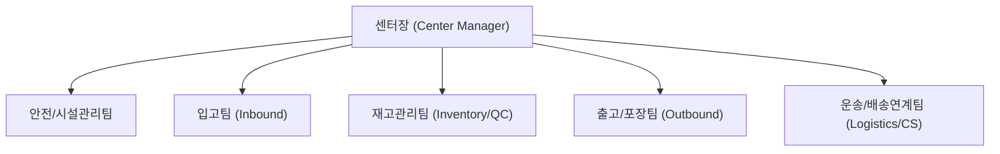

# [Chapter 1] 회사 소개 및 물류센터 기본 개요

---

## 1. 환영 인사 및 센터 비전
> **"정확하고 안전한 배송의 시작, 우리가 만듭니다."**  
> 우리 물류센터의 일원이 되신 것을 진심으로 환영합니다. 물류는 단순한 상품 보관과 이송을 넘어, 고객과의 신뢰를 연결하는 핵심 인프라입니다. 본 가이드는 신규 입사자 여러분이 안전하고 빠르게 업무에 적응할 수 있도록 지원하기 위해 제작되었습니다.

---

## 2. 센터 조직도 및 핵심 담당 부서
신규 입사자가 주로 소통하고 협업하게 될 물류센터 핵심 조직 구조입니다.

- **입고팀 (Inbound)**: 공급사로부터 들어오는 화물 하차, 수량 검수, 바코드 생성 및 전산 적재 등록.
- **재고관리팀 (Inventory Control)**: 로케이션 최적화, 정기/수시 재고 실사, 파손 및 결품 관리.
- **출고팀 (Outbound)**: 피킹(Picking), 분류(Sorting), 포장(Packing), 도크 상차.
- **안전관리팀 (EHS)**: 작업장 안전 규정 준수 감독, 보호구 지급, 보건 및 위험성 평가.

---

## 3. 물류센터 기본 레이아웃 및 동선 가이드
작업장 내 안전과 효율을 위해 구역별 성격과 이동 동선이 엄격히 구분되어 있습니다.

| 구역 명칭 | 주요 업무 및 설비 | 출입 및 안전 주의사항 |
| :--- | :--- | :--- |
| **Dock A (입고 도크)** | 화물차 접안, 랩핑 해제, 초기 하차 | 지게차 통행 구역, 안전모 필수 |
| **Storage Zone (적재존)** | 파렛트 랙(High Rack), 중경량 랙 | 랙 충돌 방지, 보행자 전용 통로 준수 |
| **Picking & Packing Zone** | 컨베이어 라인, 작업대, 완충재 설비 | 칼/테이프 디스펜서 취급 주의 |
| **Dock B (출고 도크)** | 간선 차량 및 택배 차량 상차 | 도크 개방 시 추락 주의 |
| **Rest & Office Zone** | 사무실, 휴게실, 사물함, 탈의실 | 보호구 미착용 구역 (보호구 보관소) |
