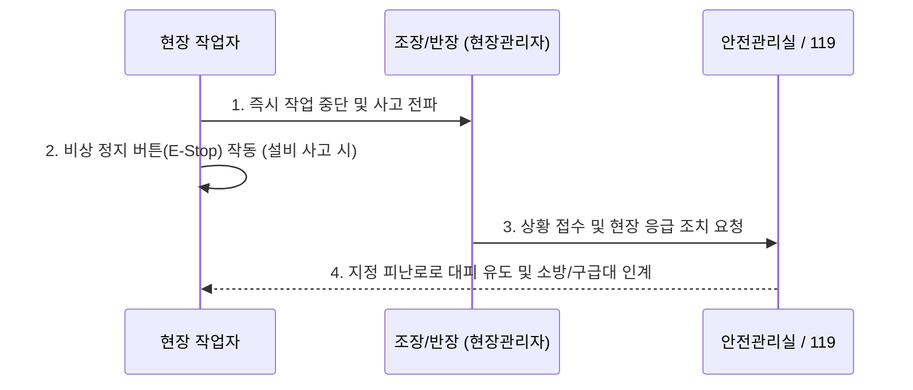

# [Chapter 2] 현장 안전수칙 및 EHS(환경·보건·안전) 규정

---

> [!IMPORTANT]
> **"생산성보다 안전이 항상 최우선입니다."**  
> 모든 작업자는 안전보호구를 착용하지 않고는 작업 구역에 진입할 수 없습니다.

## 1. 필수 착용 개인보호구 (PPE: Personal Protective Equipment)
- **안전화**: 물류센터 내 상시 필수 착용 (발가락 보호 캡 및 미끄럼 방지 기능 필수).
- **고시인성 안전조끼 (형광 조끼)**: 시야 확보가 어려운 작업장 및 지게차 이동 구역 필수 착용.
- **코팅 장갑**: 박스 이동, 칼 사용 시 손 베임 및 마찰 화상 방지.
- **안전모 (하이랙 구역)**: 2m 이상 고소 적재 구역 작업 시 의무 착용.

---

## 2. 지게차 및 중장비 작업 구역 통행 안전 수칙
1. **보행자 전용 통로(Green Line) 준수**: 바닥에 녹색으로 표시된 보행자 통로로만 이동합니다.
2. **사각지대 일단정지 & 아이컨택**: 
   - 코너를 돌거나 교차로 통과 시 반드시 멈추고 반사경을 확인합니다.
   - 지게차 운전자와 눈이 마주치고(Eye Contact) 수신호를 확인한 후 이동합니다.
3. **지게차 후방 3m 접근 금지**: 회전 반경 내에는 절대 진입하지 않습니다.
4. **포크 위 탑승 절대 금지**: 지게차 포크나 파렛트 위에 올라타는 행위는 즉각 퇴실 조치 사유입니다.

---

## 3. 비상 상황 및 응급 대처 절차
화재, 인명 사고, 누출 등 비상 상황 발생 시 표준 프로세스를 따릅니다.

- **비상정지 스위치 (E-Stop)**: 컨베이어 벨트나 자동화 소터 이상 발생 시 붉은색 버섯형 버튼을 누릅니다.
- **AED 및 구급함 위치**: 1층 로비 안내데스크 옆 및 중앙 포장 작업대 옆 벽면 비치.
- **화재 대피**: 엘리베이터 이용 금지, 비상 유도등을 따라 외부 야외 집결지(주차장)로 대피.
