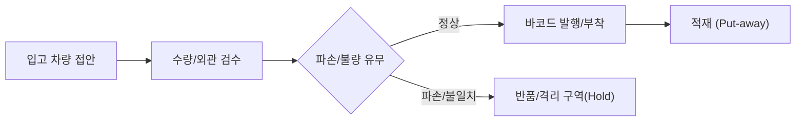

# [Chapter 3] 입고(Inbound) 및 적재(Put-away) 프로세스

> **문서 작성자**: 홍길동  
> **최종 수정일**: 2026-10-28

---

## 1. 입고 검수 및 하차 단계 (Unloading & Inspection)
입고는 물류센터의 모든 재고 데이터가 시작되는 기점입니다. 오입고는 전체 재고 불일치로 이어지므로 엄격한 검수가 필요합니다.

1. **송장 대조**: 입고 전표(ASN: Advanced Shipping Notice)와 실물 박스 수량 및 품목명을 1:1 대조.
2. **외관 검수**: 파손, 침수, 변형, 오염 여부를 확인하고 이상 발생 시 즉시 사진 촬영 후 전산 보류 처리.
3. **바코드 확인**: 물류 바코드(EAN-13, ITF-14 등) 인식이 불가능할 경우 즉시 내부 재고 바코드 라벨 재발행.

---

## 2. WMS 연동 바코드 스캔 및 적재 (Put-away)
- **PDA 스캔 순서**: `[상품 바코드 스캔]` $\rightarrow$ `[수량 입력/확인]` $\rightarrow$ `[로케이션 바코드 스캔]`.
- **선입선출(FIFO) 원칙**: 유통기한 또는 제조일자가 빠른 상품을 전면/하단에 배치합니다.
- **파렛트 적재 규격 (Palletizing)**:
  - 교차 적재(인터로킹 방식)를 적용하여 운반 중 무너짐 방지.
  - 파렛트 외곽으로 박스가 튀어나오지(오버행) 않도록 정렬 후 스트레치 필름으로 최소 3회 이상 랩핑.

---

## 3. 오입고 방지 체크리스트
- [ ] 상품 바코드 스캔 시 전산 화면의 품목명과 실물 상품의 규격/색상/옵션이 정확히 일치하는가?
- [ ] 한 파렛트에 서로 다른 SKU가 혼재(Mixed SKU)될 경우 혼재 식별표를 부착하였는가?
- [ ] 파손된 파렛트(목재 부러짐, 못 돌출)를 사용하지 않았는가?
