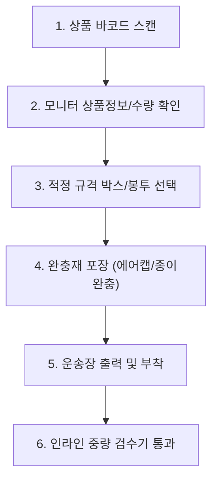

# [Chapter 5] 출고(Outbound) - 피킹(Picking) 및 패킹(Packing)

---

## 1. 주문 차수 및 피킹(Picking) 방식 비교
출고 방식은 주문 특성과 물동량에 따라 두 가지로 구분됩니다.

| 피킹 방식 | 특징 | 적용 대상 | 장단점 |
| :--- | :--- | :--- | :--- |
| **오더 피킹 (Order Picking)** | 1개 주문서마다 작업자가 직접 모든 품목을 피킹 | 대형 화물, B2B 대량 주문, 긴급 주문 | 오배송률 낮음 / 보행 동선이 길어짐 |
| **토탈/배치 피킹 (Batch Picking)** | 여러 주문의 상품을 한 번에 총량 피킹 후 분류대로 이동 | B2C 소형 택배, 다빈도 단품 주문 | 피킹 효율 극대화 / 2차 분류(DAS/DPS) 공정 필요 |

---

## 2. 포장(Packing) 표준 매뉴얼
포장은 고객이 센터의 결과물을 마주하는 최종 품질 단계입니다.

- **완충재 규격**: 박스 내부 빈 공간이 20%를 초과하지 않도록 친환경 종이 완충재 또는 에어캡 충진.
- **테이핑 원칙**: 무게 5kg 초과 화물은 H자 테이핑(중앙 1선 + 양쪽 가장자리 마감) 적용.
- **운송장 부착 위치**: 박스 상면(Top) 중앙에 평평하게 부착 (모서리 접힘, 바코드 구김 절대 금지).

---

## 3. 중량 검수 및 오배송 방지 시스템 (Weight Inspection)
- 포장 완료된 모든 화물은 컨베이어 위의 **인라인 자동 중량계(Auto Scale)**를 통과합니다.
- 기준 중량 대비 $\pm 3\%$ 오차 발생 시 자동으로 '리젝트(Reject) 라인'으로 튕겨져 나가며, 전담 검수자가 내용물을 전면 재확인합니다.
