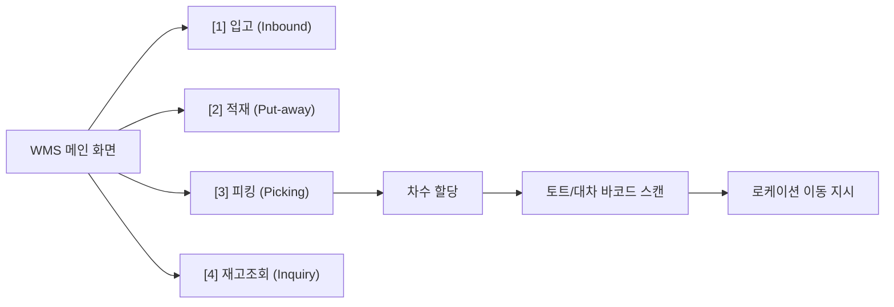

# [Chapter 6] WMS(창고관리시스템) 및 PDA 단말기 활용법

---

## 1. PDA 단말기 기본 조작 및 관리 수칙
- **부팅 및 로그인**: 센터 계정(사번) 및 담당 구역 비밀번호 입력.
- **배터리 관리**: 쉬는 시간 및 식사 시간에는 충전 거치대(Cradle)에 거치하며, 임의로 배터리를 탈착하지 않습니다.
- **스캔 주의사항**: 레이저를 사람의 눈에 직접 비추지 않으며, 스캔 거리는 15~30cm를 유지합니다.

---

## 2. WMS 화면 주요 기능 매핑
신규 작업자가 매일 사용하는 핵심 UI 메뉴 흐름입니다.

---

## 3. 오류(Error) 메시지 발생 시 대처 요령

| 오류 메시지 (Error) | 주요 발생 원인 | 조치 요령 |
| :--- | :--- | :--- |
| **"존재하지 않는 바코드"** | 타사 바코드 스캔, 바코드 훼손 | 마스터 바코드 재확인, 번호 수기 입력 시도 후 조장 보고 |
| **"로케이션 불일치"** | 지시된 위치가 아닌 인접 랙 스캔 | 상단 안내 로케이션과 랙 부착 라벨 번호 재대조 |
| **"수량 초과 입력"** | 지시 수량보다 많은 수량 스캔/입력 | 실물 개수 재카운트, 다스(Set) 상품 단품 오인 여부 확인 |
| **"네트워크 연결 끊김"** | 창고 음영 구역 진입 | 통로 중앙으로 이동 후 Wi-Fi 재연결 아이콘 확인 |
