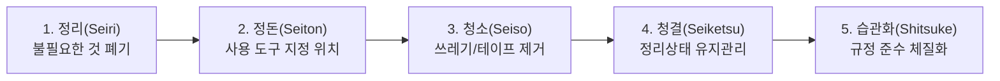

# [Chapter 7] 조직 문화, 근태 규정 및 업무 에티켓

---

## 1. 근무 시간 및 휴게 규정
- **표준 교대 근무 스케줄**:
  - 주간조: 09:00 ~ 18:00 (점심시간 12:00 ~ 13:00 / 전·후반 15분 티타임)
  - 야간조: 19:00 ~ 익일 04:00 (식사시간 23:00 ~ 24:00)
- **타임클럭(출퇴근 기록)**: 센터 출입구 지문/사원증 태그를 통해 기록되며, 1분 지각도 자동 반영되므로 작업 시작 10분 전 현장 집결을 준수합니다.

---

## 2. 작업장 5S 활동 (현장 개선의 기초)
쾌적하고 안전한 작업장을 위해 매 교대 마감 15분 전 5S 활동을 실행합니다.

---

## 3. 소통 및 보고 체계 (R&R)
- **현장 호출 신호 (무전 프로토콜)**:
  - *"OO구역 작업자 [사번/이름], OO팀 조장님 수신 바랍니다."*
  - 긴급 상황(설비 멈춤, 안전사고) 시에는 주저 없이 무전 채널 1번(비상채널)을 사용합니다.
- **고충 처리 및 피드백 창구**:
  - 현장 작업 환경, 인체공학적 개선 건의는 센터 내 '안전보건 소리함' 또는 인사 담당자 핫라인을 통해 익명으로 접수 가능합니다.

---

## 4. 신규 입사자 첫 주차 체크리스트 (Week 1 Milestones)

- [ ] **Day 1**: 사원증 발급, 안전보호구(안전화, 조끼) 수령, 비상 대피로 확인
- [ ] **Day 2**: WMS 계정 생성 및 PDA 스캐너 기본 조작 실습
- [ ] **Day 3**: 멘토와 함께 입고/적재 및 선입선출 실무 동행
- [ ] **Day 4**: 단품/배치 피킹 및 포장 표준 프로세스 실습
- [ ] **Day 5**: 5S 마감 동참 및 첫 주 온보딩 피드백 면담 완료
