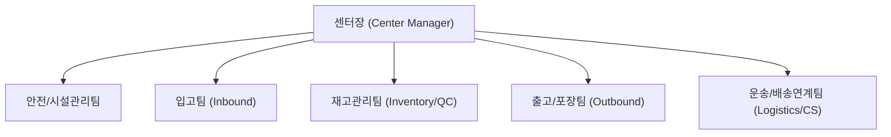
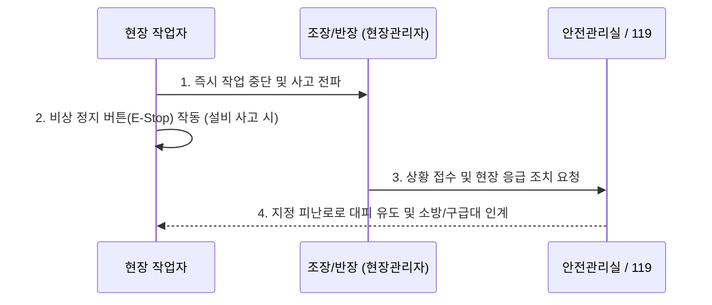
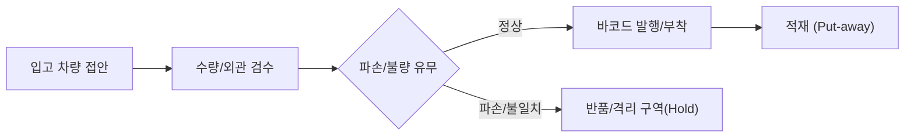
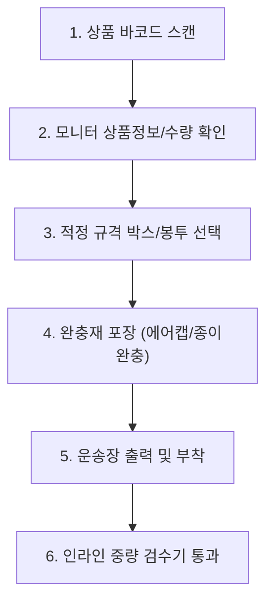
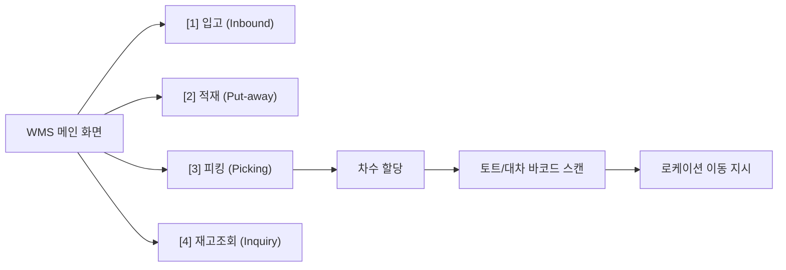
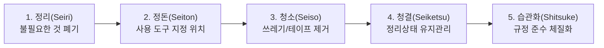

# 물류센터 신규 입사자 온보딩 가이드 (Warehouse Onboarding Manual)

---

# [Chapter 1] 회사 소개 및 물류센터 기본 개요

## 1. 환영 인사 및 센터 비전
> **"정확하고 안전한 배송의 시작, 우리가 만듭니다."**  
> 우리 물류센터의 일원이 되신 것을 진심으로 환영합니다. 물류는 단순한 상품 보관과 이송을 넘어, 고객과의 신뢰를 연결하는 핵심 인프라입니다. 본 가이드는 신규 입사자 여러분이 안전하고 빠르게 업무에 적응할 수 있도록 지원하기 위해 제작되었습니다.

---

## 2. 센터 조직도 및 핵심 담당 부서
신규 입사자가 주로 소통하고 협업하게 될 물류센터 핵심 조직 구조입니다.

- **입고팀 (Inbound)**: 공급사로부터 들어오는 화물 하차, 수량 검수, 바코드 생성 및 전산 적재 등록.
- **재고관리팀 (Inventory Control)**: 로케이션 최적화, 정기/수시 재고 실사, 파손 및 결품 관리.
- **출고팀 (Outbound)**: 피킹(Picking), 분류(Sorting), 포장(Packing), 도크 상차.
- **안전관리팀 (EHS)**: 작업장 안전 규정 준수 감독, 보호구 지급, 보건 및 위험성 평가.

---

## 3. 물류센터 기본 레이아웃 및 동선 가이드
작업장 내 안전과 효율을 위해 구역별 성격과 이동 동선이 엄격히 구분되어 있습니다.

| 구역 명칭 | 주요 업무 및 설비 | 출입 및 안전 주의사항 |
| :--- | :--- | :--- |
| **Dock A (입고 도크)** | 화물차 접안, 랩핑 해제, 초기 하차 | 지게차 통행 구역, 안전모 필수 |
| **Storage Zone (적재존)** | 파렛트 랙(High Rack), 중경량 랙 | 랙 충돌 방지, 보행자 전용 통로 준수 |
| **Picking & Packing Zone** | 컨베이어 라인, 작업대, 완충재 설비 | 칼/테이프 디스펜서 취급 주의 |
| **Dock B (출고 도크)** | 간선 차량 및 택배 차량 상차 | 도크 개방 시 추락 주의 |
| **Rest & Office Zone** | 사무실, 휴게실, 사물함, 탈의실 | 보호구 미착용 구역 (보호구 보관소) |

---
<!-- slide -->

# [Chapter 2] 현장 안전수칙 및 EHS(환경·보건·안전) 규정

> [!IMPORTANT]
> **"생산성보다 안전이 항상 최우선입니다."**  
> 모든 작업자는 안전보호구를 착용하지 않고는 작업 구역에 진입할 수 없습니다.

## 1. 필수 착용 개인보호구 (PPE: Personal Protective Equipment)
- **안전화**: 물류센터 내 상시 필수 착용 (발가락 보호 캡 및 미끄럼 방지 기능 필수).
- **고시인성 안전조끼 (형광 조끼)**: 시야 확보가 어려운 작업장 및 지게차 이동 구역 필수 착용.
- **코팅 장갑**: 박스 이동, 칼 사용 시 손 베임 및 마찰 화상 방지.
- **안전모 (하이랙 구역)**: 2m 이상 고소 적재 구역 작업 시 의무 착용.

---

## 2. 지게차 및 중장비 작업 구역 통행 안전 수칙
1. **보행자 전용 통로(Green Line) 준수**: 바닥에 녹색으로 표시된 보행자 통로로만 이동합니다.
2. **사각지대 일단정지 & 아이컨택**: 
   - 코너를 돌거나 교차로 통과 시 반드시 멈추고 반사경을 확인합니다.
   - 지게차 운전자와 눈이 마주치고(Eye Contact) 수신호를 확인한 후 이동합니다.
3. **지게차 후방 3m 접근 금지**: 회전 반경 내에는 절대 진입하지 않습니다.
4. **포크 위 탑승 절대 금지**: 지게차 포크나 파렛트 위에 올라타는 행위는 즉각 퇴실 조치 사유입니다.

---

## 3. 비상 상황 및 응급 대처 절차
화재, 인명 사고, 누출 등 비상 상황 발생 시 표준 프로세스를 따릅니다.

- **비상정지 스위치 (E-Stop)**: 컨베이어 벨트나 자동화 소터 이상 발생 시 붉은색 버섯형 버튼을 누릅니다.
- **AED 및 구급함 위치**: 1층 로비 안내데스크 옆 및 중앙 포장 작업대 옆 벽면 비치.
- **화재 대피**: 엘리베이터 이용 금지, 비상 유도등을 따라 외부 야외 집결지(주차장)로 대피.

---
<!-- slide -->

# [Chapter 3] 입고(Inbound) 및 적재(Put-away) 프로세스

## 1. 입고 검수 및 하차 단계 (Unloading & Inspection)
입고는 물류센터의 모든 재고 데이터가 시작되는 기점입니다. 오입고는 전체 재고 불일치로 이어지므로 엄격한 검수가 필요합니다.

1. **송장 대조**: 입고 전표(ASN: Advanced Shipping Notice)와 실물 박스 수량 및 품목명을 1:1 대조.
2. **외관 검수**: 파손, 침수, 변형, 오염 여부를 확인하고 이상 발생 시 즉시 사진 촬영 후 전산 보류 처리.
3. **바코드 확인**: 물류 바코드(EAN-13, ITF-14 등) 인식이 불가능할 경우 즉시 내부 재고 바코드 라벨 재발행.

---

## 2. WMS 연동 바코드 스캔 및 적재 (Put-away)
- **PDA 스캔 순서**: `[상품 바코드 스캔]` $\rightarrow$ `[수량 입력/확인]` $\rightarrow$ `[로케이션 바코드 스캔]`.
- **선입선출(FIFO) 원칙**: 유통기한 또는 제조일자가 빠른 상품을 전면/하단에 배치합니다.
- **파렛트 적재 규격 (Palletizing)**:
  - 교차 적재(인터로킹 방식)를 적용하여 운반 중 무너짐 방지.
  - 파렛트 외곽으로 박스가 튀어나오지(오버행) 않도록 정렬 후 스트레치 필름으로 최소 3회 이상 랩핑.

---

## 3. 오입고 방지 체크리스트
- [ ] 상품 바코드 스캔 시 전산 화면의 품목명과 실물 상품의 규격/색상/옵션이 정확히 일치하는가?
- [ ] 한 파렛트에 서로 다른 SKU가 혼재(Mixed SKU)될 경우 혼재 식별표를 부착하였는가?
- [ ] 파손된 파렛트(목재 부러짐, 못 돌출)를 사용하지 않았는가?

---
<!-- slide -->

# [Chapter 4] 보관(Storage) 및 재고관리(Inventory Control)

## 1. 창고 로케이션(Location) 체계의 이해
우리 센터는 6자리 표준 로케이션 코드를 사용합니다.

$$\mathbf{A - 0 3 - 0 2 - 0 1}$$

| 구분 | 예시 코드 | 설명 |
| :--- | :---: | :--- |
| **Zone (구역)** | **A** | 창고 내 물리적 구역 (A: 상온식품, B: 잡화, C: 저온) |
| **Aisle (통로)** | **03** | 작업 통로 번호 |
| **Bay (연/랙 번호)** | **02** | 통로 내 수직 랙 기둥 번호 |
| **Level (단/층)** | **01** | 바닥부터의 단수 (01단: 바닥, 04단: 최상단) |

> [!TIP]
> **골든존(Golden Zone) 관리**: 작업자의 어깨에서 허리 높이(2~3단)는 출고 빈도가 가장 높은 회전율 상위 품목(A-Class)을 배치하여 피킹 동선을 최소화합니다.

---

## 2. 재고 실사(Cycle Count) 기법
재고 정확도(Inventory Accuracy) 99.8% 달성을 위해 두 가지 실사를 병행합니다.

1. **정기 전수 실사 (Wall-to-Wall)**: 분기/반기별 센터 전체 가동을 정지하고 모든 재고를 카운트.
2. **순환 실사 (Cycle Count)**: 매일 업무 시작 전 또는 마감 후 특정 로케이션 및 고단가/불일치 빈번 품목을 선별하여 상시 카운트.

---

## 3. 결품 및 불량/반품 격리 프로세스
- **결품(Shortage) 발생 시**: 임의로 전산을 조정하지 않고, 즉시 관리자(조장)에게 보고 후 인접 로케이션 오적재 여부를 1차 수색합니다.
- **파손품(Damage)**: 발견 즉시 PDA로 '불량 처리(Hold)' 등록 후 지정된 '폐기/파손 격리대'로 이동합니다. 일반 판매 가능 재고와 섞이지 않도록 격리 펜스를 유지합니다.

---
<!-- slide -->

# [Chapter 5] 출고(Outbound) - 피킹(Picking) 및 패킹(Packing)

## 1. 주문 차수 및 피킹(Picking) 방식 비교
출고 방식은 주문 특성과 물동량에 따라 두 가지로 구분됩니다.

| 피킹 방식 | 특징 | 적용 대상 | 장단점 |
| :--- | :--- | :--- | :--- |
| **오더 피킹 (Order Picking)** | 1개 주문서마다 작업자가 직접 모든 품목을 피킹 | 대형 화물, B2B 대량 주문, 긴급 주문 | 오배송률 낮음 / 보행 동선이 길어짐 |
| **토탈/배치 피킹 (Batch Picking)** | 여러 주문의 상품을 한 번에 총량 피킹 후 분류대로 이동 | B2C 소형 택배, 다빈도 단품 주문 | 피킹 효율 극대화 / 2차 분류(DAS/DPS) 공정 필요 |

---

## 2. 포장(Packing) 표준 매뉴얼
포장은 고객이 센터의 결과물을 마주하는 최종 품질 단계입니다.

- **완충재 규격**: 박스 내부 빈 공간이 20%를 초과하지 않도록 친환경 종이 완충재 또는 에어캡 충진.
- **테이핑 원칙**: 무게 5kg 초과 화물은 H자 테이핑(중앙 1선 + 양쪽 가장자리 마감) 적용.
- **운송장 부착 위치**: 박스 상면(Top) 중앙에 평평하게 부착 (모서리 접힘, 바코드 구김 절대 금지).

---

## 3. 중량 검수 및 오배송 방지 시스템 (Weight Inspection)
- 포장 완료된 모든 화물은 컨베이어 위의 **인라인 자동 중량계(Auto Scale)**를 통과합니다.
- 기준 중량 대비 $\pm 3\%$ 오차 발생 시 자동으로 '리젝트(Reject) 라인'으로 튕겨져 나가며, 전담 검수자가 내용물을 전면 재확인합니다.

---
<!-- slide -->

# [Chapter 6] WMS(창고관리시스템) 및 PDA 단말기 활용법

## 1. PDA 단말기 기본 조작 및 관리 수칙
- **부팅 및 로그인**: 센터 계정(사번) 및 담당 구역 비밀번호 입력.
- **배터리 관리**: 쉬는 시간 및 식사 시간에는 충전 거치대(Cradle)에 거치하며, 임의로 배터리를 탈착하지 않습니다.
- **스캔 주의사항**: 레이저를 사람의 눈에 직접 비추지 않으며, 스캔 거리는 15~30cm를 유지합니다.

---

## 2. WMS 화면 주요 기능 매핑
신규 작업자가 매일 사용하는 핵심 UI 메뉴 흐름입니다.

---

## 3. 오류(Error) 메시지 발생 시 대처 요령

| 오류 메시지 (Error) | 주요 발생 원인 | 조치 요령 |
| :--- | :--- | :--- |
| **"존재하지 않는 바코드"** | 타사 바코드 스캔, 바코드 훼손 | 마스터 바코드 재확인, 번호 수기 입력 시도 후 조장 보고 |
| **"로케이션 불일치"** | 지시된 위치가 아닌 인접 랙 스캔 | 상단 안내 로케이션과 랙 부착 라벨 번호 재대조 |
| **"수량 초과 입력"** | 지시 수량보다 많은 수량 스캔/입력 | 실물 개수 재카운트, 다스(Set) 상품 단품 오인 여부 확인 |
| **"네트워크 연결 끊김"** | 창고 음영 구역 진입 | 통로 중앙으로 이동 후 Wi-Fi 재연결 아이콘 확인 |

---
<!-- slide -->

# [Chapter 7] 조직 문화, 근태 규정 및 업무 에티켓

## 1. 근무 시간 및 휴게 규정
- **표준 교대 근무 스케줄**:
  - 주간조: 09:00 ~ 18:00 (점심시간 12:00 ~ 13:00 / 전·후반 15분 티타임)
  - 야간조: 19:00 ~ 익일 04:00 (식사시간 23:00 ~ 24:00)
- **타임클럭(출퇴근 기록)**: 센터 출입구 지문/사원증 태그를 통해 기록되며, 1분 지각도 자동 반영되므로 작업 시작 10분 전 현장 집결을 준수합니다.

---

## 2. 작업장 5S 활동 (현장 개선의 기초)
쾌적하고 안전한 작업장을 위해 매 교대 마감 15분 전 5S 활동을 실행합니다.

---

## 3. 소통 및 보고 체계 (R&R)
- **현장 호출 신호 (무전 프로토콜)**:
  - *"OO구역 작업자 [사번/이름], OO팀 조장님 수신 바랍니다."*
  - 긴급 상황(설비 멈춤, 안전사고) 시에는 주저 없이 무전 채널 1번(비상채널)을 사용합니다.
- **고충 처리 및 피드백 창구**:
  - 현장 작업 환경, 인체공학적 개선 건의는 센터 내 '안전보건 소리함' 또는 인사 담당자 핫라인을 통해 익명으로 접수 가능합니다.

---

## 4. 신규 입사자 첫 주차 체크리스트 (Week 1 Milestones)

- [ ] **Day 1**: 사원증 발급, 안전보호구(안전화, 조끼) 수령, 비상 대피로 확인
- [ ] **Day 2**: WMS 계정 생성 및 PDA 스캐너 기본 조작 실습
- [ ] **Day 3**: 멘토와 함께 입고/적재 및 선입선출 실무 동행
- [ ] **Day 4**: 단품/배치 피킹 및 포장 표준 프로세스 실습
- [ ] **Day 5**: 5S 마감 동참 및 첫 주 온보딩 피드백 면담 완료
